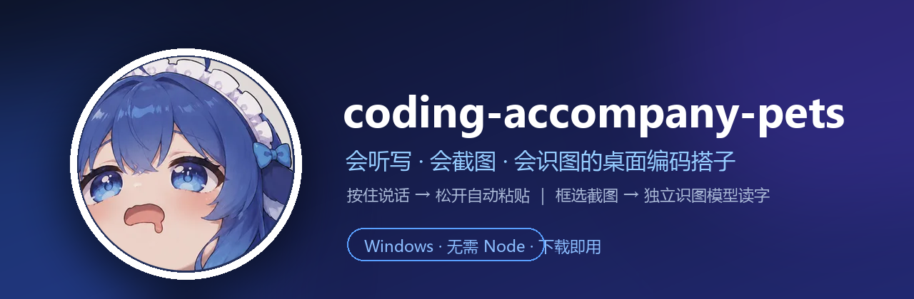

<div align="center">
  
</div>

<p align="center">
  <a href="https://github.com/Li-john1021/coding-accompany-pets/releases/latest"></a>
  
  
  
</p>

<h3 align="center">一只住在屏幕角落、会替你打字的桌宠。</h3>

<p align="center">
  按住说人话，松开得到能直接喂给 AI 的提示词；框选一块屏幕，让不会看图的大模型也能“看见”。<br>
  它大多数时候在发呆，偶尔在思考（<code>正在思考....</code>），关键时刻替你干活。
</p>

---

## 这玩意儿能干嘛？

一句话版本：**把“说”和“指”变成可以粘贴的文本。**

- 🎙️ **语音直出**：按住快捷键 / 鼠标侧键 / 长按桌宠说话，松开后自动转写、整理，写进当前光标。
- 🧠 **可选整理**：原样转写、结构化整理、优化成提示词，三种处理方式按需开关。
- ✂️ **截图工具**：`Alt+A` 冻结屏幕、框选、标注文字，确认后 PNG 直接进剪贴板。
- 👁️ **独立识图模型**：截图后点「识图」，用你单独配置的视觉模型把图里的内容读成文字，结果只写剪贴板。
- 🐱 **BongoCat 桌宠**：Live2D 键盘猫，听写时戴耳机、敲键盘；滚轮缩放，拖到哪都行。
- 📦 **第三方皮肤导入**：BongoCat / 通用 Live2D 皮肤 zip 或文件夹一键换肤；无底图、无键帽的模型也能用，自动裁边，按皮肤比例调整窗口。
- 🎨 **皮肤工坊**：19 个零件上色画板，描边自动锁定，画完起名就能换装。
- 📦 **下载即用**：安装版 / 便携版都自带 Electron 和全部运行时代码，**不需要 Node、npm 或编译环境**。

> 它不是替你写代码的 AI，而是让你少打点字的搭子。代码还是你写，废话交给它。

---

## 下载（选一个就行）

|  | 🧩 安装版 | 🎒 便携版 |
|---|---|---|
| **适合** | 长期使用，想要桌面快捷方式 | 试用、放 U 盘、不想写安装目录 |
| **文件** | [`coding-accompany-pets-Setup-1.2.0.exe`](https://github.com/Li-john1021/coding-accompany-pets/releases/download/v1.2.0/coding-accompany-pets-Setup-1.2.0.exe) | [`coding-accompany-pets-1.2.0-Portable.exe`](https://github.com/Li-john1021/coding-accompany-pets/releases/download/v1.2.0/coding-accompany-pets-1.2.0-Portable.exe) |
| **大小** | 约 74 MB | 约 74 MB |
| **怎么用** | 双击安装 → 从桌面/开始菜单启动 | 双击即运行，不写安装目录 |

👉 也可以直接打开 [**Releases 页面**](https://github.com/Li-john1021/coding-accompany-pets/releases/latest) 下载。
如果 Release 暂时打不开，仓库里的 [`release/`](release/) 目录也放着同样的两个文件；校验值见 [`release/SHA256SUMS.txt`](release/SHA256SUMS.txt)。

> **Windows 提示“未知发布者”？**
> 因为没买代码签名证书，SmartScreen 可能拦一下。点「更多信息」→「仍要运行」即可。
> 介意的话可以先用源码运行，或者自己构建。

---

## 30 秒上手

1. **下载并启动**：安装版或便携版，双击。
2. **填三个模型**：首次启动会自动打开设置页，分别填 ASR、文字模型、识图模型的 `Base URL` + `API Key` + `模型名`。
   - 三者互相独立，可以用同一家，也可以混搭。
   - 文字模型**不需要**是多模态；识图走单独的视觉模型。
3. **开始用**：
   - 默认 `Ctrl+Shift+Space` 开始/结束录音（可在设置里点「录制快捷键」改成任意组合）。
   - 默认 `Alt+A` 截图，框选后确认，PNG 进剪贴板。
   - 截图后点桌宠上的「识图」，等气泡显示 `正在读取图片中…`，结果会写进剪贴板。

### 默认操作表

| 操作 | 效果 |
|---|---|
| `Ctrl+Shift+Space` | 开始 / 结束语音听写（默认值，可改） |
| `Alt+A` | 截图并复制 PNG（默认值，可改） |
| 鼠标侧键（可选） | 开始 / 结束录音 |
| 长按桌宠 | 录音；拖动则取消（长按模式） |
| 单击桌宠 | 打开设置（长按模式）/ 开始录音（单击模式） |
| 滚轮 | 缩放桌宠 |
| 右键桌宠（单击模式） | 打开设置 |

> 录音结束后，结果会尝试直接粘贴到光标处。个别高权限应用会拦截模拟粘贴，此时会自动退化为“只复制到剪贴板”。

---

## 模型怎么配？

设置页有三张独立的列表，每张都能加多条、单选“当前使用”：

| 列表 | 用途 | 兼容性 |
|---|---|---|
| 🔊 **语音模型（ASR）** | 声音 → 文字 | OpenAI 兼容 `/audio/transcriptions`；小米 MiMo 选 `chat` 音频协议 |
| ✨ **文字模型（LLM）** | 转写结果 → 整理 / 优化 | 任意 OpenAI 兼容 `/chat/completions` |
| 🖼️ **识图模型（Vision）** | 截图 / 剪贴板图片 → 文字 | 任意 OpenAI 兼容视觉端点 |

几个常见组合：

- **小米 MiMo**：ASR 选 `chat`，Base URL `https://api.xiaomimimo.com/v1`，模型名 `mimo-v2.5-asr`；文字和识图可以用 `mimo-v2.6-flash`。
- **OpenAI 兼容中转**：Base URL 填到 `/v1` 即可，填完整路径也兼容。
- **本地 Ollama**：Base URL `http://localhost:11434/v1`。
- **纯文本模型 + 视觉模型**：文字模型随便选，识图模型单独填一个能看图的端点即可。

每条模型旁的「校验」会发一个最小探测请求，确认地址、Key、模型名真的能调通。识图校验会发一张内置小图；**不会**在启动或后台轮询时偷偷调用模型。

---

## 截图与识图：它到底怎么工作？

1. 按 `Alt+A`（或点桌宠的截图按钮）→ 屏幕冻结，拖一个框。
2. 浮条上可以确认、取消、加文字标注；确认后选区变成 PNG 进剪贴板。
3. 点桌宠的「识图」→ 气泡显示 `正在读取图片中…` → 独立识图模型返回文字 → **只写入剪贴板**，不自动粘贴、不继续优化。
4. 之后你可以像平常一样 `Ctrl+V`，或者把文字交给文字模型继续处理。

识图按钮只有在“识图模型配置完整 + 剪贴板里有实际图片 + 当前没有冲突操作”时才可用；不可用时点它会直接告诉你原因，不会装死。

---

## 隐私与数据

- **没有遥测、没有账号、没有后台偷偷上传。**
- 只有你主动触发语音 / 识图时，才会把音频 / 图片发给你在设置里配置的模型端点。
- 配置、模型、皮肤、录音恢复数据都在本机：`%APPDATA%\Voice2Prompt`。
  - 这是改名前的目录名，1.1.0 起特意沿用，升级不会丢配置。
  - API Key 只做了 base64 轻度混淆，**不是加密**；别把 `config.json` 发到公开的地方。
- 截图只写入系统剪贴板；识图结果也只写入剪贴板，不会自动替你发送。

---

## 常见问题

<details>
<summary><b>安装版和便携版有什么区别？</b></summary>

功能完全一样。安装版会创建桌面快捷方式、带卸载器；便携版双击即用，适合放 U 盘或临时试用。
</details>

<details>
<summary><b>为什么配置目录叫 Voice2Prompt，不是新名字？</b></summary>

软件从 1.1.0 起改名成了 `coding-accompany-pets`，但配置目录沿用了旧路径，目的是让老用户的模型、皮肤和录音恢复数据无缝保留。以后如果迁移目录，会提供一次性迁移。
</details>

<details>
<summary><b>识图按钮是灰的 / 点了没反应？</b></summary>

先看设置页的「识图模型」有没有填完整（Base URL + 模型名，Key 按你的端点要求），并设成当前使用；再确认剪贴板里确实有图片；录音、截图、粘贴过程中也会暂时不可用。按钮不可用时点一下会弹出具体原因。
</details>

<details>
<summary><b>桌宠不动 / 没有 Live2D？</b></summary>

发布包里已包含 Live2D 运行时。若你从源码运行，需要自行从 [Live2D 官网](https://www.live2d.com/sdk/download/web/) 下载 **Cubism SDK for Web R5（Core 6.0.1+）**，把 `Core/live2dcubismcore.min.js` 放到 `app/renderer/lib/`。新版 MOC3 v6 皮肤（例如 DeepSeek 大肥鱼）必须用这个版本；旧版 Core 5.1 会提示版本过旧。没有该文件时桌宠会回退成静态图片，其他功能不受影响。第三方皮肤导入说明见 [`docs/skin-import.md`](docs/skin-import.md)。
</details>

<details>
<summary><b>需要联网吗？</b></summary>

软件本身不需要联网启动，也不需要 Node/npm；但语音转写、文字整理、识图都要调用你配置的云端（或本地）模型端点。
</details>

<details>
<summary><b>为什么安装包这么大？</b></summary>

里面塞了完整的 Electron 运行时和所有第三方原生模块，换来的是“下载就能用”，不用装 Node、不用 `npm install`、不用编译。
</details>

<details>
<summary><b>杀毒软件报毒？</b></summary>

未签名的 Electron 应用偶尔会被启发式误报。可以核对 `release/SHA256SUMS.txt` 的哈希，或直接从源码构建。
</details>

---

## 从源码运行 / 开发

运行时第三方代码已经 vendor 到 `app/vendor/`，`npm install` 只会装 Electron 和 electron-builder 两个开发依赖：

```bash
cd app
npm install
npm start
```

构建 Windows 产物（在仓库根目录执行，输出到 `app/dist-exe/`）：

```bash
./app/node_modules/.bin/electron-builder --win portable nsis --publish never
```

跑测试：

```bash
# 单元测试（43 个）
for f in app/main/*.unit.test.js app/renderer/*.unit.test.js; do node "$f" || exit 1; done

# 关键运行时测试（需要可交互的 Windows 桌面）
node app/main/screenshot-library.runtime.test.js
node app/main/pet-restore-ui.runtime.test.js
node app/main/pet-actions-v5-settings.e2e.test.js
node app/main/screenshot-vision-p5.e2e.test.js
```

目录速览：

```
app/
  main/        Electron 主进程：语音管线、截图、识图、托盘、热键
  renderer/    设置页、桌宠、截图 UI、皮肤画板
  assets/      内置皮肤、画板素材、托盘图标
  vendor/      随包分发的第三方运行时代码（含许可证清单）
docs/          皮肤指南、测试报告、证据与状态存档
release/       可直接下载的安装版 / 便携版与校验值
```

---

## Credits & License

- 本项目代码：[MIT](LICENSE)
- 截图：[electron-screenshots](https://github.com/nashaofu/electron-screenshots)（MIT）、
  [node-screenshots](https://github.com/nashaofu/node-screenshots)（Apache-2.0）、
  [react-screenshots](https://github.com/nashaofu/react-screenshots)（MIT）
- 键鼠钩子：[uiohook-napi](https://github.com/SnosMe/uiohook-napi)（MIT）
- 桌宠渲染：[PixiJS](https://pixijs.com/)（MIT）、
  [pixi-live2d-display](https://github.com/guansss/pixi-live2d-display)（MIT）
- 内置键盘猫皮肤：来自 [ayangweb/BongoCat](https://github.com/ayangweb/BongoCat)（模型文件以该仓库为准）
- 内置大肥鱼皮肤：来自 [mefist-asuka/Deepseek-standard-mode](https://github.com/mefist-asuka/Deepseek-standard-mode)；角色/贴图版权归 赤风RED、EmoteLab，随仓库自用，商用/再分发请确认原作者授权
- Live2D Cubism Core：Live2D Proprietary，源码仓库不提交，需自行下载；发布包由本机构建并包含本机副本，再分发前请确认 Live2D 条款
- 应用图标与 README 主视觉：项目使用的插画素材，版权归原作者所有；仅用于本项目展示，单独复用前请先取得授权

第三方运行时代码的版本、许可证和保留文件清单见 [`app/vendor/README.md`](app/vendor/README.md)。

### 致谢 BongoCat 生态

- [MMmmmoko/Bongo-Cat-Mver](https://github.com/MMmmmoko/Bongo-Cat-Mver)：最早的 Bongo Cat C++ overlay（MIT），也是“装饰性操作演示”这一形态的源头；本项目桌宠的灵感与皮肤约定都从这里来。
- [ayangweb/BongoCat](https://github.com/ayangweb/BongoCat)：现代桌面版 BongoCat，内置键盘猫模型、`resources/left-keys` 皮肤结构和 `CatParam*` 参数约定以该仓库为准。
- [ayangweb/Awesome-BongoCat](https://github.com/ayangweb/Awesome-BongoCat)：第三方皮肤索引；本项目测试过的乃琳、罗小黑、阮梅、小熊猫昊昊、逍遥散人等皮肤均来自该列表，版权归各作者，自用请注明来源。
- [mefist-asuka/Deepseek-standard-mode](https://github.com/mefist-asuka/Deepseek-standard-mode)：内置大肥鱼资源包；角色/贴图版权归 赤风RED、EmoteLab，工程参考与 `psd2live` 工具由 阿特ers、常日缠 开源。
- [Bongo-Cat-Mver 转换站](https://bongocat.vteamer.cc)：老资源转新格式的社区工具。

再次感谢以上作者把模型、工具和桌面宠物形态开源出来。第三方皮肤版权归各原作者，本项目只做本地导入与展示，不主张任何皮肤权利。

---

<p align="center">
  如果这只搭子帮你少打了几行废话，欢迎点个 ⭐；<br>
  遇到问题也可以开 Issue，附上复现步骤和（打码后的）设置截图。
</p>